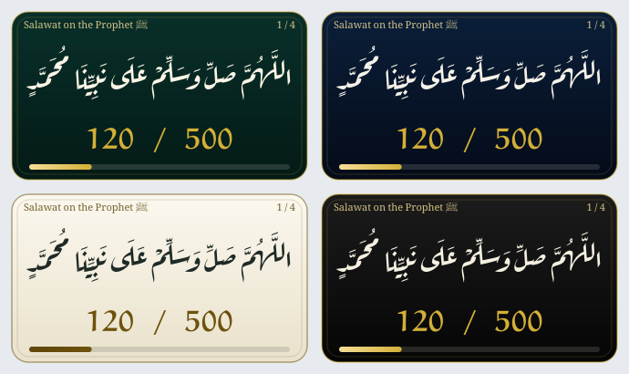
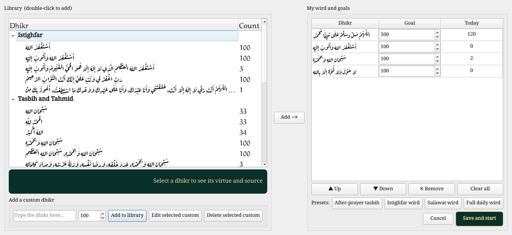
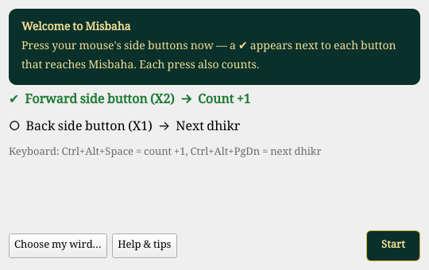
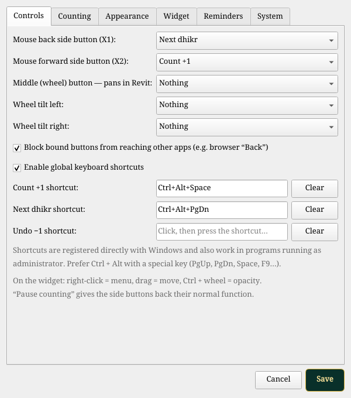

# مِسبحة — Misbaha

**A hands-free, always-on-top dhikr counter for Windows.**
Count istighfar, tasbih and salawat with your **mouse side buttons** while you keep working — in Revit, AutoCAD, a browser or any other program — without moving the mouse or switching windows.

<p align="center">
  
</p>

<p align="center">
  
</p>

<p align="center">
  
  &nbsp;
  
</p>

## Features

- **Count from anywhere** — mouse side buttons X1 / X2, plus optional middle button and wheel tilt left/right, and global keyboard shortcuts (default `Ctrl+Alt+PgUp` = +1, `Ctrl+Alt+PgDn` = next dhikr).
- **Never in the way** — floating widget that never takes keyboard focus, optional click-through mode (hold <kbd>Ctrl</kbd> over it to interact), auto-dim when idle, hides over full-screen videos and slideshows.
- **Adhkar library** — 23 authentic adhkar with their virtue and source, presets (after-prayer tasbih, istighfar, salawat, full daily wird) and your own custom adhkar.
- **Your wird and goals** — order, goals, auto-advance, loop, daily reset.
- **Statistics** — today, last 7 days, day streak, all-time total.
- **Gentle reminders** — a notification when you haven't made dhikr for a while, with quiet hours; never while you are away from the PC or in a full-screen app.
- **10 colour themes** + custom colours, 4 bundled Arabic fonts, English / Arabic interface, Arabic-Indic digits.
- **First-run button test** — see live which mouse buttons reach Misbaha (menu → *Test mouse buttons*).
- **Update notice** — once a day Misbaha asks GitHub whether a newer release exists and, if so, offers to open its download page. Nothing is downloaded or installed automatically; turn it off in Settings → System.
- **Private** — no account, no telemetry, no personal data sent. Everything is stored in one file on your PC.

## Download

Get `Misbaha.exe` from the [Releases](../../releases) page and run it — no installation needed.
Right-click the widget (or the tray icon) for the menu.

> Windows SmartScreen or your antivirus may warn about a new, unsigned program that watches mouse buttons. Misbaha only reacts to the buttons you bind; the full source is here and every release is built by GitHub Actions from this repository with hash-locked dependencies. Each release includes `Misbaha.exe.sha256` — compare it with `certutil -hashfile Misbaha.exe SHA256`.

## Run from source

Requirements: Windows 10/11, [Python 3.9+](https://www.python.org/downloads/) (tick **Add python.exe to PATH**).

```bat
run.bat          :: installs PySide6 on first run, then starts Misbaha (no console)
run_debug.bat    :: same, with a console so you can see errors
build_exe.bat    :: builds dist\Misbaha.exe (single portable file)
```

Or manually:

```bat
python -m pip install -r requirements.txt
pythonw Misbaha.pyw
```

## Using it

| Action | How |
|---|---|
| +1 | Mouse forward side button **X2** (default), or `Ctrl+Alt+PgUp` |
| Next dhikr | Mouse back side button **X1** (default), or `Ctrl+Alt+PgDn` |
| Menu | Right-click the widget or the tray icon |
| Show the widget again | Click the tray icon (hiding is done from the menu) |
| Move | Drag the widget |
| Opacity | <kbd>Ctrl</kbd> + mouse wheel over the widget |
| Pause | Menu → *Pause counting* — side buttons get their normal function back |

All bindings can be changed in **Settings → Controls**. Shortcuts are recorded by clicking the field and pressing the keys.

## Troubleshooting

- **Side buttons don't count inside one program** — that program probably runs *as administrator*. Windows hides its mouse input from normal programs. Use *Restart as administrator* from the menu, or the keyboard shortcuts (they always work).
- **Side buttons don't count anywhere** — mouse software (Logitech Options+ / G HUB, Razer Synapse, X-Mouse Button Control…) may be capturing them. Set the button in that software to *send a keystroke* (Misbaha's shortcut), or back to the default Back/Forward. *Help & tips* in the menu shows the exact keys and an AutoHotkey example.
- **A shortcut doesn't work** — another program already uses it; Misbaha tells you which one failed. Pick another in Settings.
- **Logs** — `%APPDATA%\Misbaha\error.log` (and `crash.log` if the app ever froze or crashed). Please attach them to bug reports.

## Network use

The only connection Misbaha makes is the optional daily update check: one HTTPS request to
`api.github.com/repos/<this repository>/releases/latest`, identified only as `Misbaha/<version>`.
It never downloads or runs anything; it only opens the release page in your browser when you choose to.
Builds made from source without a GitHub remote don't check at all.

## Data and portable mode

Settings, wird, counters and history are stored in `%APPDATA%\Misbaha\state.json` (with a daily backup `state.json.bak`).
For a portable setup (USB stick), create a folder named `misbaha-data` next to `Misbaha.exe` — data is then kept there instead.

## How it works

| Part | File | Notes |
|---|---|---|
| Mouse buttons | `misbaha/input_hook.py` | A `WH_MOUSE_LL` hook on its own high-priority thread. Mouse moves are passed on immediately, so the cursor never lags. A swallowed button-down always swallows its button-up, so no app ever sees a "stuck" click. |
| Shortcuts | `misbaha/input_hook.py` | `RegisterHotKey` — no keyboard hook, nothing you type is ever seen, works with any keyboard layout. |
| Watchdog | `misbaha/app.py` | Detects when Windows silently drops the hook (sleep, lock, heavy load) and reinstalls it instantly; detects elevated apps instead of restarting needlessly; dumps thread stacks to `crash.log` if the UI ever freezes. |
| Overlay | `misbaha/widget.py`, `misbaha/winapi.py` | Non-activating tool window; click-through via native window styles; opacity is painted (no layered-window tricks); timers run only while something animates. |
| Storage | `misbaha/state.py` | Validated on load, written atomically on a background thread, daily backup, corrupt files quarantined. |

## Security

See [SECURITY.md](SECURITY.md) for what Misbaha does on your PC and how to report a vulnerability privately,
and [docs/SIGNING.md](docs/SIGNING.md) for code-signing the release exe.

## Contributing

Issues and pull requests are welcome — see [CONTRIBUTING.md](CONTRIBUTING.md). New adhkar must include an authentic source. Run the tests with:

```bat
python -m unittest discover -s tests -v
```

## License

Misbaha is released under the [MIT License](LICENSE).
The bundled fonts (Aref Ruqaa, Amiri, Reem Kufi, Noto Naskh Arabic) are under the SIL Open Font License — one licence file per font in [`misbaha/fonts/`](misbaha/fonts/).

---

## بالعربية

**مِسبحة** عدّاد أذكار عائم فوق كل النوافذ، تعدّ به **بزر الفأرة الجانبي** دون تحريك الفأرة أو ترك عملك — حتى داخل Revit وAutoCAD.

- **+١**: الزر الجانبي الأمامي (X2) أو `Ctrl+Alt+PgUp` — **الذكر التالي**: الزر الجانبي الخلفي (X1) أو `Ctrl+Alt+PgDn`.
- نقرة يمين على الودجت أو أيقونة شريط المهام = القائمة. اسحب لتحريكه. Ctrl + العجلة = الشفافية.
- مكتبة أذكار بفضلها ومصدرها، وِرد وأهداف، إحصائيات، تذكير لطيف مع أوقات هدوء، ١٠ ألوان ولون مخصص، واجهة عربية أو إنجليزية.
- بلا حساب ولا تتبّع. الاتصال الوحيد: التحقق مرة يوميًا من وجود إصدار جديد على GitHub (يمكن إيقافه)، دون تنزيل أو تثبيت تلقائي. البيانات في `%APPDATA%\Misbaha\state.json`.
- إذا كان Revit يعمل **كمسؤول** اختر «إعادة التشغيل كمسؤول» من القائمة، أو استخدم اختصارات لوحة المفاتيح.

تقبّل الله منا ومنكم.
